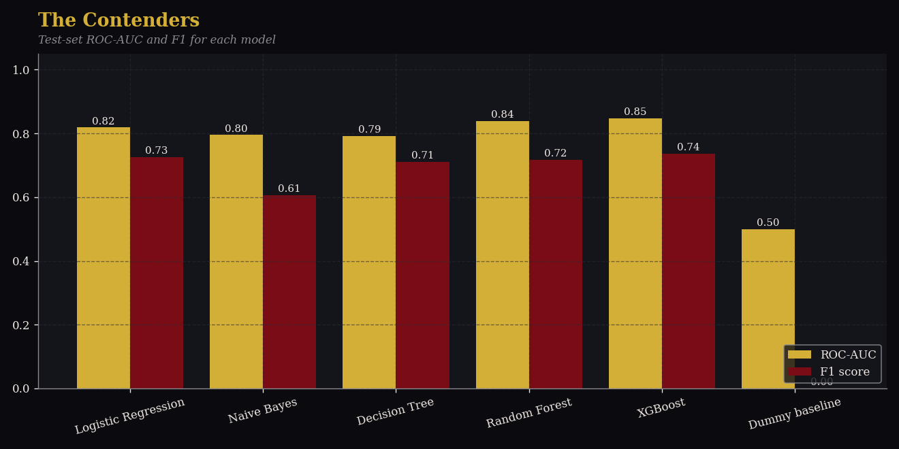
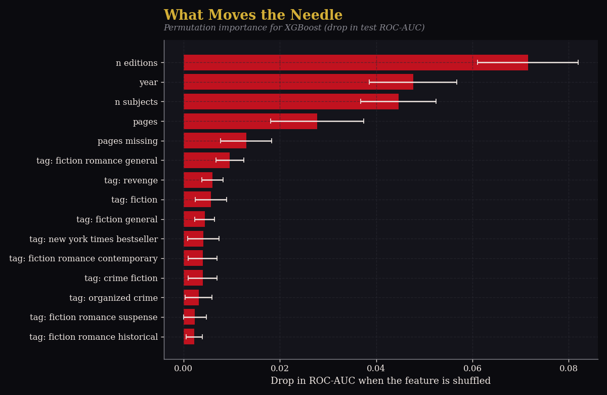
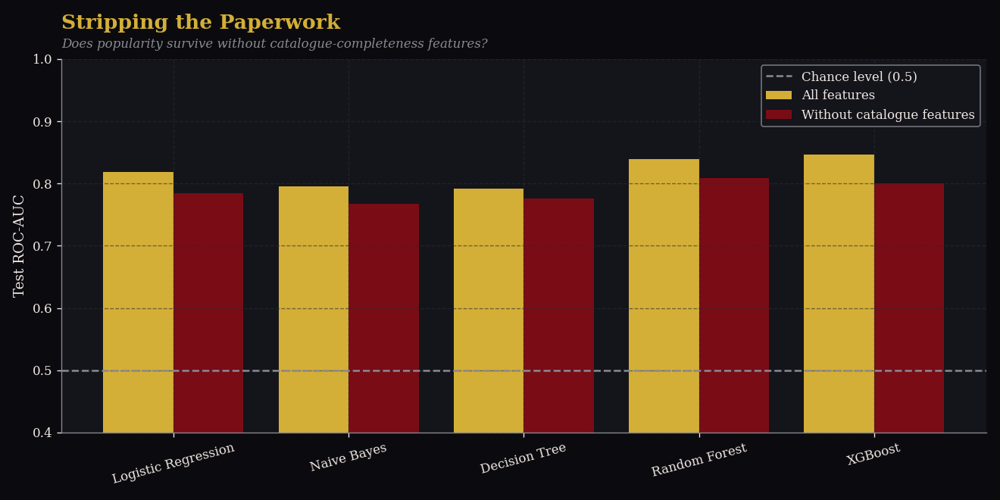

# What Makes a Dark Romance Book Popular?

A comparative predictive analysis of 2,493 dark and mafia romance books collected from the Open Library API.



## Overview

Dark romance is one of the most discussed fiction genres, yet little data explains which books readers add to their reading lists. This project builds an original dataset from the Open Library API, cleans it, tests hypotheses about what separates popular books from the rest, and compares five machine learning models that predict popularity.

**Question:** can page count, publication year, edition count and subject tags predict whether a book is popular?

**Target:** a book is *popular* if its want-to-read count is above the median (the median is 2, so popular means 3 or more readers). The two classes are balanced: 52.1% not popular and 47.9% popular.

## Key findings

- **XGBoost reached 0.847 ROC-AUC and 76.3% accuracy on unseen books**, against 0.500 and 52.0% for the baseline that always predicts the majority class.
- **Random Forest and XGBoost are statistically tied** (corrected resampled t-test, p = 0.94). XGBoost was selected because it overfits less: its gap between training and cross-validated ROC-AUC is 0.062, against 0.091 for Random Forest.
- XGBoost beats Naive Bayes and Decision Tree significantly, and beats Logistic Regression only narrowly (p = 0.034, which does not survive a Bonferroni correction for four comparisons).
- **Popular books are older, longer, and have more editions and subject tags.** The strongest effects are editions (rank-biserial r = 0.46) and publication year (r = -0.40).
- **Books with no page count are popular only 21.4% of the time**, against 63.2% when it is filled in (Cramer's V = 0.40).
- **Average rating does not differ** between popular and not-popular books (3.89 vs 3.91, p = 0.84), although the not-popular group has few rated books (n = 89).
- Only books published before 2010 stand out in want-to-read counts. The 2010-2014, 2015-2019 and 2020-2026 periods do not differ from each other (Tukey post-hoc test).
- **Without the catalogue-completeness features, XGBoost still reaches 0.801 test ROC-AUC** (0.820 cross-validated), so page count, publication year and subject tags carry real signal.

## Dataset

- **Source:** [Open Library](https://openlibrary.org) Search API, collected with 30 genre queries (mafia romance, enemies to lovers, bratva, arranged marriage and others), up to 4 pages of 100 results each.
- **Size:** 2,493 unique books collected. After de-duplication, 1,834 books have a want-to-read count and are used for modelling.
- **Raw fields:** title, authors, first publication year, median page count, average rating, ratings count, want-to-read, already-read, currently-reading and reading-log counts, edition count and subject tags.
- **Fixed snapshot:** the collected file is included as `data/books_raw.csv`. Open Library changes over time, so re-running the collection may give different results.

## Methodology

1. **Cleaning and visualization** (`01_cleaning_visualization.py`): duplicate removal, invalid page counts and years set to missing, missing-value flags, subject tags turned into 25 yes/no features, target creation, and seven charts.
2. **EDA and statistical analysis** (`02_eda_statistical_analysis.py`): summary statistics, normality checks, Spearman correlations, Mann-Whitney U, Welch t-test, chi-square tests with Bonferroni correction, one-way ANOVA, Kruskal-Wallis and Tukey post-hoc tests.
3. **Model development and evaluation** (`03_model_development_evaluation.py`):
   - Five models: Logistic Regression, Gaussian Naive Bayes, Decision Tree, Random Forest and XGBoost, plus a Dummy baseline.
   - One stratified 80/20 split, grid search with 5-fold cross-validation, and repeated 5-fold cross-validation (3 repeats) for comparison.
   - Imputation and scaling happen inside each pipeline, so no information leaks from the test set.
   - Models are compared with a paired t-test and the corrected resampled t-test of Nadeau and Bengio.
   - Permutation importance explains the selected model.
   - A robustness experiment removes `n_editions`, `n_subjects` and the missing-value flags.

**Leakage control:** `want_to_read`, `already_read`, `reading_now`, `readinglog` and `n_ratings` are reader-activity counts and are never used as features.

## Results

Test-set results with all 31 features (cross-validated ROC-AUC is the mean of 15 folds):

| Model | CV ROC-AUC | Accuracy | Precision | Recall | F1 | ROC-AUC |
|---|---|---|---|---|---|---|
| Random Forest | 0.838 | 0.744 | 0.763 | 0.676 | 0.717 | 0.839 |
| **XGBoost (selected)** | 0.837 | **0.763** | 0.787 | 0.693 | **0.737** | **0.847** |
| Logistic Regression | 0.819 | 0.757 | 0.792 | 0.670 | 0.726 | 0.819 |
| Naive Bayes | 0.799 | 0.700 | 0.817 | 0.483 | 0.607 | 0.795 |
| Decision Tree | 0.783 | 0.730 | 0.731 | 0.693 | 0.711 | 0.792 |
| Dummy baseline | n/a | 0.520 | 0.000 | 0.000 | 0.000 | 0.500 |

The test set holds about 367 books, so differences of one or two points are within noise. The cross-validated scores are the more reliable basis for comparing models.





## Limitations

- **Popular is relative.** It means 3 or more want-to-read adds within this niche, not bestseller status.
- **Catalogue completeness is partly confounded with popularity.** Popular books tend to have fuller records (page count, editions, subject tags), so part of what the models learn is how well documented a book is. Removing the explicit completeness features lowers XGBoost's test ROC-AUC from 0.847 to 0.801, but some tags (for example *new york times bestseller*) still reflect success.
- **Age is a confounder.** Older books have had more time to collect want-to-read adds.
- **Ratings are sparse.** Only 665 modelled books have a rating, and most not-popular books have none, so rating cannot be used as a target.
- **Association, not causation.** The analysis describes relationships and does not show that any feature makes a book popular.
- **Small test set and grid edges.** A few tuned values (Naive Bayes `var_smoothing`, XGBoost `max_depth`) sit at the edge of the search grid.

## Repository structure

```
dark-romance-analysis/
├── data/          books_raw.csv, books_clean.csv, source coverage checks
├── notebooks/     01_cleaning_visualization.py
│                  02_eda_statistical_analysis.py
│                  03_model_development_evaluation.py
├── src/           collect_books.py, theme.py, coverage check scripts
├── models/        best_model.joblib, model_info.json
├── reports/       figures/ (16 charts), statistical and model result tables (CSV)
├── requirements.txt
└── README.md
```

## How to reproduce

```bash
git clone https://github.com/S83-ai/dark-romance-analysis.git
cd dark-romance-analysis
pip install -r requirements.txt
python notebooks/01_cleaning_visualization.py
python notebooks/02_eda_statistical_analysis.py
python notebooks/03_model_development_evaluation.py
```

The notebooks are Python files with `# %%` cell markers, so they run cell by cell in Spyder or VS Code, and as plain scripts. Close each chart window when running as a script. The three notebooks were run in two separate Python environments (Python 3.12 and 3.14) and gave identical results. Running `src/collect_books.py` is optional, because the collected dataset is included.

## Tools

Python, pandas, NumPy, SciPy, scikit-learn, XGBoost, Matplotlib and Seaborn, with a custom red-and-black chart theme.

## Author

Sanchali Singh, B.Tech Computer Science and Engineering (Data Science minor), Lovely Professional University. Built for the Predictive Analysis course (CA2).

Data courtesy of [Open Library](https://openlibrary.org), a project of the Internet Archive.